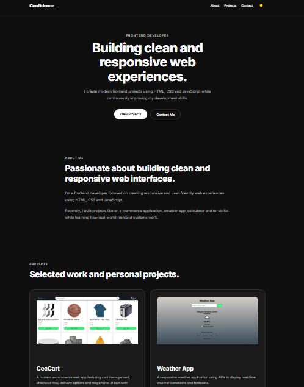

# 💼 Confidence – Frontend Developer Portfolio

A modern, responsive portfolio built with HTML, CSS and vanilla JavaScript, showcasing my frontend projects and skills in React, TypeScript and JavaScript.

---

## 🚀 Live Demo

🔗 https://ceecee-portfolio.vercel.app/

---

## ✨ Features

- 🌙 Dark / Light mode toggle (saved with localStorage)
- 📱 Fully responsive design
- 🍔 Mobile navigation menu
- 🎯 Active section highlighting while scrolling
- ✨ Scroll reveal animations
- 🖼️ Project showcase cards with live demo and GitHub links
- 📬 Contact section
- ⬆️ Smooth back-to-top navigation

---

## 🛠️ Built With

- HTML5
- CSS3
- JavaScript (Vanilla JS)
- Deployed on Vercel

---

## 📂 Featured Projects

| Project | Tech | Links |
| --- | --- | --- |
| 🏢 ManagAI Clone – SaaS landing site | React, React Router, Vite | [Live](https://managai-clone.vercel.app/) · [Code](https://github.com/Ceecee-ferdy/managai-clone) |
| 💬 Chatbot UI – chat interface | React, TypeScript, Vite | [Live](https://chatbot-project-sigma-eosin.vercel.app/) · [Code](https://github.com/Ceecee-ferdy/chatbot-project) |
| 🛒 CeeCart – E-commerce web app | HTML, CSS, JavaScript | [Live](https://ceecart.vercel.app/) · [Code](https://github.com/CeeCee-Ferdy/CeeCart) |
| 🌦️ Weather App | HTML, CSS, JavaScript, API | [Live](https://weather-app-eight-mu-18.vercel.app/) · [Code](https://github.com/Ceecee-ferdy/ceeweather) |
| ✅ To-Do App | HTML, CSS, JavaScript | [Live](https://todo-app-three-sand-52.vercel.app/) · [Code](https://github.com/Ceecee-ferdy/todo-app) |
| 🧮 Calculator App | HTML, CSS, JavaScript | [Live](https://calculator-app-eta-orpin.vercel.app/) · [Code](https://github.com/Ceecee-ferdy/calculator-app) |

---

## 📚 What I Learned

- Structuring scalable frontend projects
- Building responsive layouts and testing on real phones
- Creating reusable UI sections and components
- Managing theme persistence with localStorage
- Implementing scroll-based interactions
- Improving accessibility and UI polish
- Deploying and debugging apps on Vercel

---

## 📸 Screenshot

---

## 💻 Run Locally

1. Clone the repository
2. Open `index.html` in your browser, or use a local server such as the VS Code Live Server extension

---

## 📬 Contact

- Upwork: https://www.upwork.com/freelancers/~016563b1ff6294c947
- GitHub: https://github.com/Ceecee-ferdy
- Twitter/X: https://x.com/Ceecee_Chi